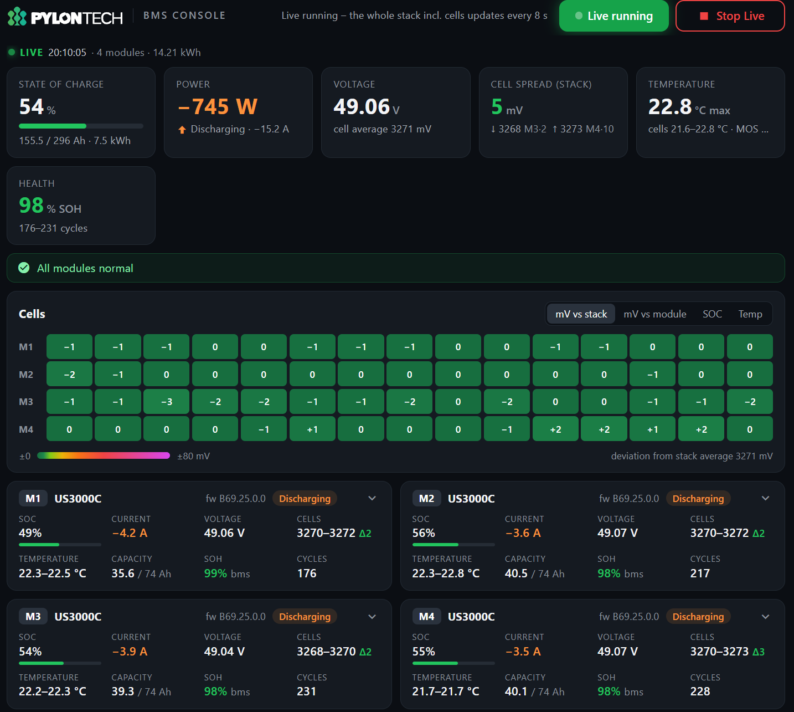

# pylontech-rs232-venus

Per-module **Pylontech BMS monitoring** for **Victron Cerbo GX / Venus OS**, read over the
battery's **RS232 console port** through a USB/RS232 adapter — with a Node-RED dashboard.

> **This branch (`pylontech-remote`) is work in progress** towards a remote equivalent of
> Pylontech BatteryView: a realtime dashboard now, and soon a complete history/event archive kept
> beyond what the battery stores (~37 days), exported in the format Pylontech support asks for.
> Design: [ARCHITECTURE.md](ARCHITECTURE.md) · Console findings: [docs/CONSOLE-NOTES.md](docs/CONSOLE-NOTES.md).
> Based on the original project by **Martin (tejno)** — see [Credits](#credits).

The Victron CAN bus only exposes pack-level aggregates. The RS232 console of the **master** module
gives **per-module and per-cell** data for the whole stack: cell voltages, temperatures, SOC, SOH,
balancing, cycle counts, BMS thresholds — and the history and event records of every module.



---

## Status

| Part | State |
|---|---|
| Realtime dashboard (Live switch) | **works** — `pylontech_live.py` + `nodered/pylontech_flow.json` |
| Read-only safety (command allow-list) | **works** — `pylontech_remote/allowlist.py`, covered by tests |
| History / event research, slave modules through the master | **done** — [docs/CONSOLE-NOTES.md](docs/CONSOLE-NOTES.md) |
| History archive (SQLite), incremental sync, BatteryView export | planned — [ARCHITECTURE.md](ARCHITECTURE.md) |
| Long-running service, boot persistence, new installer | planned — the old `install.sh` is **legacy**, see below |

Verified on a 4× US3000C stack, firmware B69.25.0.0, Venus OS v3.81 (Cerbo GX).
Other firmwares may differ (see the notes).

---

## Safety

- The battery only ever receives **read** commands. Every command passes one allow-list
  (`pylontech_remote/allowlist.py`) before a byte is written; commands that change, clear, test or
  control anything (`time`, `datac`, `config <x> <val>`, `shut`, `ctrl`, …) are refused. Tests
  assert this.
- Nothing on the Victron side is changed (no ESS/DVCC/BMS settings, no D-Bus battery service). The
  BMS-CAN link is not touched.
- The port is opened exclusively, with DTR/RTS low before opening (the battery does not answer with
  them asserted).

---

## Hardware

| Item | Detail |
|---|---|
| Adapter | USB ↔ RS232. **FTDI (FT232R) recommended** — it has a serial number, so the udev rule follows the cable to any USB socket. A CH340 works too (tested), but has no serial number: the rule then matches the USB socket. |
| Cable | RJ45 → DB9 into the **Console** port of the **master** module only — the master relays the slaves. |
| Link | 115200 8N1, no flow control, **DTR/RTS = False** |

### Keep Venus OS away from the port

Venus OS's `serial-starter` probes every USB serial adapter as one of its own devices (an FT232R as
RS485, a CH340 as a Zigbee energy-meter converter) and writes probe traffic to the battery console.
A udev rule must set `VE_SERVICE=ignore` for the adapter. Two details matter:

- name the file so it sorts **after** `serial-starter.rules`, e.g. `zz-pylontech-console.rules`
  (a `99-…` rule is processed first and then overridden);
- `/etc` is replaced by a Venus OS update — re-create the rule after updating (boot persistence is
  part of the planned service).

```
# FTDI: by serial number   (udevadm info -q property -n /dev/ttyUSB0 | grep ID_SERIAL_SHORT)
ACTION=="add", SUBSYSTEM=="tty", ENV{ID_SERIAL_SHORT}=="YOURSERIAL", ENV{VE_SERVICE}="ignore"
# adapter without serial (e.g. CH340): by vendor/product + USB socket   (… | grep -E 'ID_VENDOR_ID|ID_MODEL_ID|ID_PATH')
ACTION=="add", SUBSYSTEM=="tty", ENV{ID_VENDOR_ID}=="1a86", ENV{ID_MODEL_ID}=="7523", ENV{ID_PATH}=="platform-1c14400.usb-usb-0:1:1.0", ENV{VE_SERVICE}="ignore"
```

Apply it to that port only (serial-starter then releases the port by itself):

```bash
udevadm control --reload-rules
udevadm trigger --action=add --subsystem-match=tty --sysname-match=ttyUSB0
udevadm info -q property -n /dev/ttyUSB0 | grep VE_SERVICE     # → VE_SERVICE=ignore
fuser /dev/ttyUSB0                                               # → nothing
```

---

## Install (current, manual)

Prerequisites on the Cerbo: root SSH, Venus OS **Large** (Python 3 + pyserial are included),
Node-RED with **Dashboard 2.0** (`@flowfuse/node-red-dashboard`, install from the palette manager).

```bash
# from a checkout of this branch on your PC
ssh root@<cerbo-ip> 'mkdir -p /data/pylontech/app/pylontech_remote'
scp pylontech_live.py root@<cerbo-ip>:/data/pylontech/app/
scp pylontech_remote/*.py root@<cerbo-ip>:/data/pylontech/app/pylontech_remote/

# test on the Cerbo: one full read, prints one JSON line
ssh root@<cerbo-ip> 'python3 /data/pylontech/app/pylontech_live.py --once'
```

Then in Node-RED: delete an older **Battery** tab if present → Menu → **Import**
`nodered/pylontech_flow.json` → **Deploy** (choose *Modified Flows* so other flows are not
restarted) → open `http://<cerbo-ip>:1880/dashboard/battery` and switch **Live** on.

Every change made on a Cerbo for this project is listed with its undo in
[CHANGES-ON-CERBO.md](CHANGES-ON-CERBO.md).

### Legacy `install.sh` / `pylontech_reader.py`

The original one-shot reader and installer are still in the repo. Known limits: the installer
only detects FTDI adapters, writes a `99-…` rule that `serial-starter.rules` overrides, restarts
serial-starter and may run `opkg`/`pip`. Use the manual steps above instead; a new installer is
planned.

---

## Dashboard

- **Live** switch: starts `pylontech_live.py`, which keeps the port open and every **8 s** reads
  the stack summary (`pwr`) and the cells of every module (`bat N`) — the whole page updates at
  once. Model, serial, firmware, SOH, cycles and thresholds are read when Live starts, SOH and
  cycles again every 10 min. Live switches itself off after **30 min** and frees the port.
- Pack summary: SOC, current, temperature, capacity (Ah + kWh), SOH, total cell spread.
- Per module: model, serial, firmware, SOC, current, temperature, capacity, SOH (`bms`/`est`),
  cycles, Bat-HV alarm count, age of the cell data.
- 15-cell colour bar using the battery's own thresholds from `config`.

Command-line options (`python3 pylontech_live.py --help`): `--port` (or env `PYLONTECH_PORT`,
default `/dev/ttyUSB0`), `--interval`, `--gap` (minimum pause between commands, default 1.2 s),
`--max-minutes`, `--once`.

---

## Repository

```
pylontech_live.py         realtime reader (JSON lines on stdout)
pylontech_remote/         allow-list, console session, parsers, stack state
nodered/                  Node-RED flow (Dashboard 2.0)
tests/                    unit tests + captured console replies (python -m unittest discover -s tests -t .)
tools/console_capture.py  research tool: saves raw console replies (allow-listed commands only)
docs/CONSOLE-NOTES.md     what the console does: commands, record formats, BatteryView export
ARCHITECTURE.md           design of the full service (archive, sync, export, maintenance)
CHANGES-ON-CERBO.md       log of every change made on the Cerbo
install.sh, pylontech_reader.py, udev/   legacy, from the original project
```

---

## Troubleshooting

**`port_open: … held by pid …` / Live does not start** — something else has the port:
```bash
fuser /dev/ttyUSB0                                         # who holds it
udevadm info -q property -n /dev/ttyUSB0 | grep VE_SERVICE   # must be "ignore"
```
If `VE_SERVICE` is not `ignore`, the udev rule is missing (e.g. after a Venus OS update) or the
cable is in a different USB socket than the rule expects.

**Battery returns nothing** — check DTR/RTS (must be off), the cable is in the **Console** socket of
the master, and nothing else holds the port. `python3 pylontech_live.py --once` prints the error.

---

## Credits

Original project **pylontech-rs232-venus** by **Martin (tejno)** — reader, installer and the
dashboard widget this branch builds on. If it saved you time, support him:
[](https://ko-fi.com/tejnoo) → **[ko-fi.com/tejnoo](https://ko-fi.com/tejnoo)**

## License

MIT — see [LICENSE](LICENSE) (copyright Martin (tejno); changes in this fork under the same license).

Not affiliated with Pylontech or Victron Energy. Use at your own risk; reading the console is
passive but you are responsible for your own battery system.
